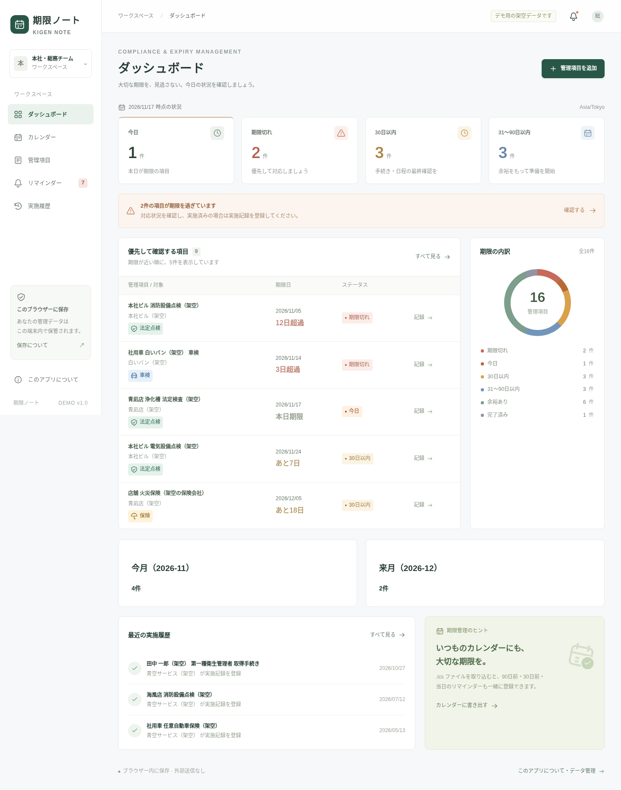

# 法定点検・資格・車検の期限カレンダー

## 概要

小さな会社・店舗の総務担当が、法定点検・車検（自賠責含む）・資格／免許・保険の満期や更新期限をまとめて管理する日本語デモです。画面上の名称は「期限ノート」です。

## 主な機能

1. **期限登録とカレンダー**：名称・種類・対象・担当者・期限・周期（月数または1回限り）・起算方法・メモを登録。追加・編集・削除、種類／担当者／状態／キーワードの絞り込み、期限順／名称順の並べ替えに対応します。月カレンダーは前月・翌月・今日へ移動でき、日付から期限一覧を確認できます。スマートフォンでは日ごとの縦リストになります。
2. **3段階のリマインド**：90日前・30日前・当日を表示し、期限を過ぎた項目を「期限切れ」に分類します。確認済みは期限日と段階ごとに保存され、次の段階では未確認になります。ナビゲーションに未確認件数を表示します。1件または絞り込み結果をICSとしてダウンロードでき、各予定に90日前・30日前・当日の3アラームが付きます。完了済みは出力しません。
3. **実施記録と自動更新**：実施日・実施者／実施先・任意の費用・メモを入力すると、次回期限をプレビューして自動更新します。前回期限・実施日を履歴に保存し、直近の記録を取り消すと期限と状態が戻ります。実施履歴では年ごとの件数・費用合計を確認できます。

「前回期限から」では早めに実施しても、次回期限は前回期限＋周期になります。「実施日から」では実施日＋周期です。月末を超える場合はその月の末日に調整し、うるう年も考慮します。周期なしは実施で完了済みになります。

状態は期限切れ／今日／30日以内（残り1〜30日）／90日以内（残り31〜90日）／余裕あり／完了済みです。ダッシュボードに最初の4状態の件数、直近の期限トップ5、今月・来月の件数を表示します。

## 既存作品との違い

種類の異なる期限を同じ基準で並べ、段階ごとの確認と実施記録からの期限更新に焦点を当てています。設備のチェックリスト・修理対応・保全KPIや、車両の配車・運行管理は扱いません。認証・外部API・データベースは使わず、メール・プッシュ通知等の外部送信も行いません。ICSの通知動作は取り込み先の設定に依存します。

## 画面一覧

| URL           | 画面                                                         |
| ------------- | ------------------------------------------------------------ |
| `/`           | ダッシュボード                                               |
| `/calendar`   | カレンダー                                                   |
| `/items`      | 期限一覧・絞り込み・追加・ICS                                |
| `/items/[id]` | 詳細・編集・実施記録・取り消し・削除                         |
| `/reminders`  | 段階別リマインド・確認済み                                   |
| `/history`    | 実施履歴・年別集計                                           |
| `/about`      | デモ説明・計算ルール・既定データへのリセット・JSON保存と復元 |

## 技術スタック

Next.js 16（App Router）／React 19／TypeScript／Tailwind CSS 4／CSS／localStorage／ESLint／Prettier。ロジックのテストはNode.js標準のテストランナーを使用します。

画面と部品は `src/components/` に分割しています。`src/lib/` の `dates.ts`、`schedule.ts`、`ics.ts`、`seed.ts`、`storage.ts`、`types.ts` に日付・状態・更新・取り消し・保存検証を分離しています。

## 公開URL

https://compliance-expiry-calendar.vercel.app

## スクリーンショット



04はスマートフォン幅（390×844）、それ以外はデスクトップ幅（1440px）で公開URLから撮影しています。

| 画面                       | 画像                                              |
| -------------------------- | ------------------------------------------------- |
| ダッシュボード             | [01-dashboard](docs/screenshots/01-dashboard.png) |
| カレンダー                 | [02-calendar](docs/screenshots/02-calendar.png)   |
| リマインド                 | [03-reminders](docs/screenshots/03-reminders.png) |
| 実施記録（スマホ 390×844） | [04-record](docs/screenshots/04-record.png)       |
| 期限一覧                   | [05-items](docs/screenshots/05-items.png)         |

## ローカル起動方法

Node.js 22.18以降を使用し、このフォルダ直下で実行します。

```sh
npm ci
npm run dev
```

http://localhost:3000 を開きます。本番モードは `npm run build` の後に `npm start` で起動します。

```sh
npm run lint
npm run typecheck
npm test
npm run build
npx --no-install prettier --check .
```

テストは月末・うるう日・年末、起算方法、自動更新、完了、取り消し、通知段階、確認済み、状態境界、絞り込み・並べ替え、ICS、保存形式、複数の今日でのシード内訳を検証します。Prettierの行幅は100です。

## デモデータについて

16件の項目と31件の過去の実施記録はすべて架空です。実在の企業・個人・住所とは無関係です。日付は初回に開いた日の日本時間の今日から相対的に生成し、固定日付は使用しません。期限切れ2件、当日1件、30日以内3件、90日以内3件、余裕あり6件、周期なし完了済み1件を用意しています。各項目に1〜3件の実施履歴があり、一部には費用と確認済みのリマインドがあります。

日付はAsia/Tokyoの暦日を `YYYY-MM-DD` で扱い、初期読み込みと今日の決定はマウント後に行います。保存先のキーは `cec:v1`、内部形式はversion 2です。古い形式・破損データはその日の既定データに置き換え、画面で通知します。保存が利用できない場合はエラーを表示します。

既定データへのリセットはその時点の日本時間の今日で再生成します。データはブラウザー内だけに保存され、端末間同期はありません。サイトデータを削除すると消えるため、必要に応じてJSONバックアップを保存してください。周期と期限は説明用であり、実際の期限は証明書や担当機関で確認してください。
